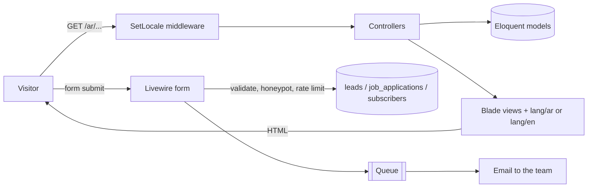
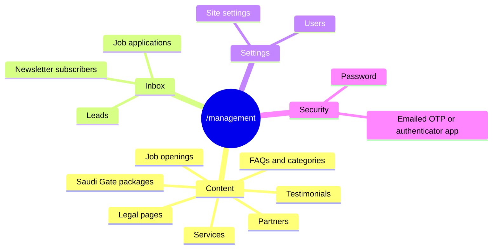

# Advisory Channels Website

> The new marketing website and content dashboard for **Advisory Channels** (قنوات الاستشارات), a Saudi
> consulting firm. It replaces the Wix site at advisory.com.sa and follows the structure of the
> Drovox website, rebuilt on **Laravel 13**. Fully **bilingual (Arabic first, English)** and RTL-aware.

🌐 **Languages:** [English](#english) · [العربية](#العربية)

---

# English

## 📑 Table of Contents

1. [Overview](#1-overview)
2. [Tech Stack](#2-tech-stack)
3. [Project Structure](#3-project-structure)
4. [Architecture Diagrams](#4-architecture-diagrams)
5. [Features in Detail](#5-features-in-detail)
6. [Routing Map](#6-routing-map)
7. [Localization (AR / EN)](#7-localization-ar--en)
8. [Getting Started](#8-getting-started)
9. [Environment Variables](#9-environment-variables)
10. [Front-End Build](#10-front-end-build)
11. [Testing](#11-testing)
12. [Deployment Checklist](#12-deployment-checklist)
13. [Content Still Needed](#13-content-still-needed)

---

## 1. Overview

A server-rendered Laravel application that serves:

- **Public pages:** Home, About, Services (index + one page per service), Saudi Gate, Careers
  (openings + apply), FAQs, Contact and Request a Service.
- **Legal pages:** Privacy Policy and Terms & Conditions. Their content is stored in the `docs` table and
  edited from the dashboard.
- **Lead capture:** a three-step *Request a Service* wizard, a *Saudi Gate* enquiry form, a contact form,
  job applications with CV upload, and a newsletter sign-up. Everything is stored in the database, and the
  team gets an email for each new lead or application.
- **An admin dashboard** at `/management`. It is protected by login plus an emailed one-time code (OTP),
  like the Drovox dashboard, and is built with Filament.

## 2. Tech Stack

| Layer | Technology | Notes |
|-------|-----------|-------|
| **Language** | PHP `^8.3` | |
| **Framework** | Laravel `^13` | MVC, Blade, Eloquent, queues, notifications |
| **Admin dashboard** | Filament `^5` | `/management`, Arabic RTL UI, two-factor sign-in |
| **Interactive forms** | Livewire `^4` + Alpine.js | Alpine ships with Livewire |
| **CSS** | Tailwind CSS `^4` | Logical utilities (`ms-`, `ps-`, `start-`) so one codebase serves RTL and LTR |
| **Motion** | GSAP + ScrollTrigger, Lenis | Scroll reveals, counters, Saudi Gate progress line; turned off when the visitor prefers reduced motion |
| **Sliders** | Swiper | Saudi Gate stages and testimonials |
| **Fonts** | IBM Plex Sans Arabic (the Royal Commission sites' typeface), IBM Plex Sans, Fraunces serif for English headlines | Self-hosted at build time by the Laravel Vite font plugin (+ fontaine fallbacks) |
| **Build** | Vite | `vite.config.js` |
| **Database** | SQLite locally, MySQL / PostgreSQL in production | |
| **Testing** | PHPUnit | `tests/Feature/Site`, `tests/Feature/Admin` |

## 3. Project Structure

```text
advisory-channels/
├── app/
│   ├── Enums/                    # LeadType, LeadStatus, ApplicationStatus, JobType (with labels & colours)
│   ├── Filament/                 # Admin dashboard: Resources/, Pages/ManageSiteSettings, Widgets/
│   ├── Http/
│   │   ├── Controllers/          # HomeController, ServiceController, CareerController,
│   │   │                         #   FaqController, ContactController, SitemapController
│   │   └── Middleware/SetLocale  # Applies the /{locale} prefix
│   ├── Livewire/                 # RequestServiceForm, SaudiGateForm, ContactForm,
│   │   └── Concerns/             #   JobApplicationForm, SubscribeForm (+ spam guard & locale traits)
│   ├── Models/                   # Service, GatePackage, JobOpening, JobApplication, Lead, Doc,
│   │                             #   Faq, FaqCategory, Testimonial, Partner, Subscriber, Setting, User
│   ├── Notifications/            # NewLeadReceived, NewJobApplicationReceived (queued mail)
│   └── Support/                  # SiteSettings, Translatable, Localization, LeadInbox
├── config/site.php               # Supported locales and the lead notification address
├── database/
│   ├── migrations/
│   └── seeders/                  # Real copy from the old site + Arabic drafts
├── lang/{ar,en}/                 # Split by page, like Drovox: header, footer, index, about,
│                                 #   services, gate, careers, faqs, contact, request, forms, admin…
├── resources/
│   ├── css/app.css               # Tailwind theme (brand colours, fonts, components)
│   ├── js/                       # app.js (motion, sliders), network-canvas.js (hero animation)
│   └── views/
│       ├── layouts/app.blade.php #   Main layout
│       ├── inc/                  #   head, header, footer, scripts, floating-contact
│       ├── index.blade.php       #   Home
│       ├── pages/                #   about, saudi-gate, faqs, contact, request-service, doc
│       ├── services/  careers/   #   index + show (+ careers/apply)
│       ├── livewire/             #   Form views
│       └── components/           #   ui/* (button, icon, field, faq-list, page-hero…), site/logo
├── routes/web.php
└── tests/Feature/{Site,Admin}/
```

## 4. Architecture Diagrams

### 4.1 Request flow



### 4.2 Admin dashboard domains (`/management`)



## 5. Features in Detail

| Area | What it does | Key files |
|------|--------------|-----------|
| **Translatable content** | Translatable columns are JSON `{"ar": "…", "en": "…"}`; `$model->tr('title')` picks the current language and falls back to the other one | `Models/Concerns/HasTranslations`, `Support/Translatable` |
| **Site settings** | Contact details, social links, hero and about copy, home statistics and logo, all editable | `Support/SiteSettings`, `Filament/Pages/ManageSiteSettings` |
| **Saudi Gate** | Seven-stage journey with a scroll progress line, investor FAQs and an enquiry form that records the chosen stages | `pages/saudi-gate.blade.php`, `Livewire/SaudiGateForm` |
| **Request a Service** | Three-step wizard; `?service=slug` preselects a service | `Livewire/RequestServiceForm` |
| **Careers** | Openings with closing dates, applications with CV upload. CVs are stored on the private disk and deleted together with their application | `Livewire/JobApplicationForm`, `Models/JobApplication` |
| **Spam protection** | Honeypot field and a limit of 5 submissions per IP every 10 minutes | `Livewire/Concerns/GuardsSubmissions` |
| **Alerts** | Queued email to `notification_email` (site setting) or `LEADS_NOTIFY_EMAIL`, always in Arabic, with a link to the record | `Notifications/*`, `Support/LeadInbox` |
| **SEO** | Per-page title and description, canonical and `hreflang` links, Organization JSON-LD, `/sitemap.xml` with both languages, 301 redirects from the old Wix URLs | `inc/head.blade.php`, `SitemapController`, `routes/web.php` |
| **Insights** | Articles, reports, guides and news with featured story, type filter, reading time, author, share rail, reading progress bar, PDF download, related pieces and Article JSON-LD. Drafts (no date) and scheduled posts stay hidden | `InsightController`, `insights/*`, `Models/Insight` |
| **Our Impact** | Metric-led case studies (challenge / approach / outcome, up to 4 metrics, clients described rather than named). The page and menu link appear only once a story is published | `CaseStudyController`, `impact/*` |
| **Leadership** | Profiles on the About page, shown once added | `Models/TeamMember`, `pages/about.blade.php` |
| **Mega menus** | Services and Saudi Gate menus with descriptions (McKinsey / BCG), plus a utility bar | `inc/header.blade.php` |
| **Contact routing & RFPs** | The contact form asks for the purpose first; tender invitations can attach the RFP document (private disk, deleted with the lead) | `Livewire/ContactForm` |
| **Floating contact** | WhatsApp button when a number is set, otherwise a link to the contact page (the Drovox chat bubble) | `inc/floating-contact.blade.php` |

## 6. Routing Map

| URL | Name | Notes |
|-----|------|-------|
| `/` | — | Redirects to `/ar` |
| `/{locale}` | `home` | `locale` is `ar` or `en` |
| `/{locale}/about` | `about` | |
| `/{locale}/services`, `/{locale}/services/{slug}` | `services.index`, `services.show` | |
| `/{locale}/saudi-gate` | `saudi-gate` | |
| `/{locale}/careers`, `/careers/apply`, `/careers/{slug}` | `careers.*` | |
| `/{locale}/faqs` | `faqs` | |
| `/{locale}/contact`, `/{locale}/request-service` | `contact`, `request-service` | |
| `/{locale}/privacy-policy`, `/{locale}/terms-and-conditions` | same | Content from `docs` |
| `/sitemap.xml` | `sitemap` | |
| `/about-3`, `/services-6`, `/saudi-gate`, `/general-5`, `/general-8` | — | 301 redirects from the old Wix site (`?lang=ar` keeps Arabic) |
| `/management` | Filament | Admin dashboard |

## 7. Localization (AR / EN)

- Locales are declared in `config/site.php`. The first one, Arabic, is the default.
- `SetLocale` reads the `{locale}` URL segment, sets the app locale and makes `route()` fill it in
  automatically, so views never pass the locale by hand.
- Livewire update requests have no locale in their URL, so form components remember it themselves
  (`Livewire/Concerns/RemembersLocale`).
- UI strings live in `lang/{ar,en}/<page>.php`. **Add every new key to both languages.**
- The admin dashboard follows the default locale (Arabic, RTL).

## 8. Getting Started

```bash
composer install
npm install
cp .env.example .env
php artisan key:generate
php artisan migrate --seed      # creates the admin from ADMIN_EMAIL / ADMIN_PASSWORD
php artisan storage:link
npm run build
composer run dev                # server, queue worker, logs and Vite together
```

- The site is at `http://127.0.0.1:8000/ar`, and the dashboard at `/management`.
- Signing in emails a one-time code. Locally, mail goes to `storage/logs/laravel.log`.

## 9. Environment Variables

| Key | Purpose |
|-----|---------|
| `APP_LOCALE=ar`, `APP_FALLBACK_LOCALE=en` | Default and fallback language |
| `FILESYSTEM_DISK=public` | Uploaded images. CVs always use the private `local` disk |
| `LEADS_NOTIFY_EMAIL` | Fallback address for lead alerts (the site setting takes priority) |
| `ADMIN_EMAIL`, `ADMIN_PASSWORD` | First admin account created by the seeder |
| `MAIL_*` | SMTP settings. Required for alerts **and** the sign-in codes |
| `QUEUE_CONNECTION` | Alerts and sign-in codes are queued, so a worker must run |

## 10. Front-End Build

```bash
npm run dev     # Vite dev server with hot reload
npm run build   # production build into public/build
```

- Brand tokens live in `resources/css/app.css`: brand green `#017337` (`brand-700`), deep royal greens
  (`forest-*`), desert sand (`sand-*`) and gold (`gold-*`) for fine details.
- `.heading-display` gives the light, large headline style; `[data-split]` headings rise line by line.
- `.pattern-star` is the Najdi-inspired eight-point star lattice; `.bracket-frame` is the logo's bracket motif in gold.

## 11. Testing

```bash
php artisan test
```

- `tests/Feature/Site` covers every page in both languages, the old-URL redirects, the sitemap, every
  form (validation, honeypot, rate limit, alerts, CV storage) and locale handling.
- `tests/Feature/Admin` covers dashboard access, two-factor sign-in, every resource and the site
  settings page.

## 12. Deployment Checklist

- [ ] Real SMTP credentials in `MAIL_*`. Without them nobody can sign in, because sign-in codes are emailed.
- [ ] A queue worker kept running by Supervisor (`php artisan queue:work`), plus the scheduler cron.
- [ ] `APP_ENV=production`, `APP_DEBUG=false`, HTTPS, then `php artisan optimize`.
- [ ] Point the DNS from Wix to the new server.
- [ ] Submit `/sitemap.xml` in Google Search Console.
- [ ] Have the privacy policy and terms (both marked as drafts) reviewed for PDPL compliance.
- [ ] Choose hosting with data residency in Saudi Arabia in mind, since the site stores CVs and personal data.

## 13. Content Still Needed

- The official logo as SVG. Upload it in *Site settings → General*; until then a placeholder mark is shown.
- The official Arabic trade name. «قنوات الاستشارات» is a placeholder, editable in *Site settings*.
- A review of all the Arabic copy, which was drafted from the English site.
- Phone, WhatsApp, address and map link.
- Real testimonials and partner logos. Both sections stay hidden until they have content.
- Case studies, leadership profiles and photos. Each section stays hidden until it has content.
- Hero and about photography (*Site settings → Home / About*). Until then the design uses its own patterns.
- A review of the three launch insights, which were written from the site's existing copy.

---

# العربية

## نظرة عامة

الموقع الجديد لشركة **قنوات الاستشارات**. يحل محل موقع Wix الحالي، ويتبع هيكلة موقع Drovox، ومبني على
**Laravel 13**. يعمل بالعربية (اللغة الافتراضية) والإنجليزية، مع دعم كامل للاتجاه من اليمين لليسار.

- **صفحات الموقع:** الرئيسية، من نحن، الخدمات مع صفحة لكل خدمة، البوابة السعودية، الوظائف والتقديم عليها،
  الأسئلة الشائعة، تواصل معنا، اطلب خدمة، سياسة الخصوصية، والشروط والأحكام.
- **النماذج:** طلب خدمة على ثلاث خطوات، استفسار البوابة السعودية، التواصل، التقديم على الوظائف مع رفع السيرة
  الذاتية، والاشتراك في النشرة البريدية. كل الطلبات تُحفظ في قاعدة البيانات، ويصل الفريق بريد بكل طلب جديد.
- **لوحة التحكم** على `/management`. الدخول فيها بكلمة المرور ثم رمز تحقق (OTP) يُرسل بالبريد، مثل لوحة Drovox.
  واجهتها عربية بالكامل.

## التقنيات

Laravel 13 · Filament 5 · Livewire 4 · Tailwind CSS 4 · GSAP · Lenis · Swiper · خطا Tajawal وManrope.

## التشغيل محلياً

```bash
composer install && npm install
cp .env.example .env && php artisan key:generate
php artisan migrate --seed && php artisan storage:link
npm run build && composer run dev
```

## قبل الإطلاق

- **البريد (SMTP):** أعدّه قبل أي شيء، لأن رمز الدخول للوحة التحكم يُرسل بالبريد.
- **مشغّل الطوابير (Queue worker):** يجب أن يعمل باستمرار.
- **الصفحات القانونية:** راجع سياسة الخصوصية والشروط قانونياً وفق نظام حماية البيانات الشخصية.
- **محتوى ينقص:**
  - الشعار بصيغة SVG.
  - الاسم التجاري العربي الرسمي.
  - الهاتف والعنوان.
  - آراء العملاء وشعارات الشركاء.
